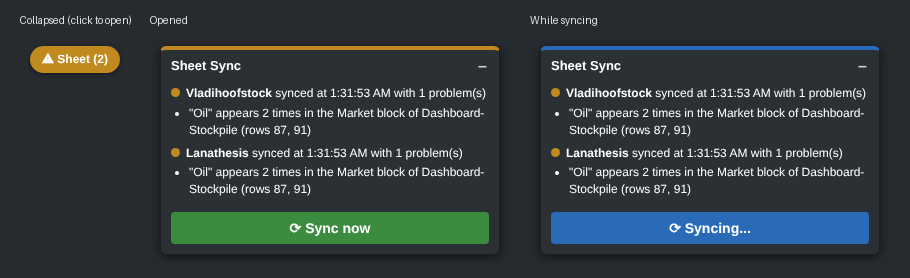

# CLOP Sheet Sync (Tampermonkey userscript)

`clop-sheet-sync.user.js` keeps the shared CLOP planning spreadsheet up to date from your own
logged-in 4clop.org session. There's no Python, no password to store, and nothing to keep running.
While your browser is open, it reads your pages and writes your numbers to the sheet, for every
nation on your login.

It only **reads** the game. The one thing it does in CLOP is switch your session to another nation
and back, so it can read that nation (see [Your other nations](#your-other-nations)).

## Install

1. Install [Tampermonkey](https://www.tampermonkey.net/) or [Violentmonkey](https://violentmonkey.github.io/)
   in your browser (on Firefox, both are on addons.mozilla.org). **Greasemonkey 4 won't work.** It
   only has an async API and no way for tabs to see each other's changes, which the script relies
   on. Under Greasemonkey the script just shows a note saying so.
2. Open `clop-sheet-sync.user.js` from this repo's **Raw** view. Tampermonkey offers to install it.
   (You can also go to Tampermonkey → *Create a new script*, paste the file in, and save.)
3. The first time it connects to 4clop.org and to the sheet, Tampermonkey asks for permission.
   Choose **Always allow** for `4clop.org`, `script.google.com` and `script.googleusercontent.com`.

Tampermonkey will list the script as running on every site. That's how it keeps syncing when you
have no 4clop.org tab open. On other sites it shows nothing and never reads the page. All it does
there is the 2-minute timer and its own requests to 4clop.org and the sheet.

## Set up

Go to **User → User Info** in the game. Above the password form there's a new
**Spreadsheet Sync** table. It has one row for every nation in your empire, taken from the game's
nation dropdown, so you fill them all in at once without switching:

| Field | What to type | Example |
|---|---|---|
| **Dashboard Column Name** | That nation's header in row 1 of the `Dashboard-Stockpile` tab, exactly as written | `Vladihoofstock(Z)` |
| **Sheet Name** | The name of that nation's own tab, exactly as written (brackets included) | `Vladihoofstock(Z)` |

You usually don't have to type anything. For every empty row, the form looks in row 1 of the
Dashboard for a column named after the nation (on its own or followed by its region tag, like
`(Z)`). It also checks which tab exists, and fills both in with a note saying it found them. Check
them, then click **Save Sheet Settings**. Nothing is saved until you do.

Saving syncs every nation right away. The lines under the buttons say how each one went. Leave a row
empty to skip that nation.

## What it writes

Every cell is found by **looking its label up**, never by a fixed row number. Adding rows to the
sheet doesn't break anything. If a label is missing or duplicated, only the block it belongs to is
skipped, and the status line names the problem.

**Your nation tab** (Sheet Name), from `overview.php`:

- **Buildings.** Column B under the `Building` header (rows 9–51 today) gets your *have* count.
  Column B under `DISABLED:` (rows 58–97 today) gets how many are disabled. Game names map to the
  sheet's labels, so `Basic Copper Mine` becomes `Basic Mine`, every `DNA Extraction Facility - …`
  becomes `DNA`, and `Solar Collector` + `Tidal Generator` both become `Energy Collector`.
- **STOCK block.** The `HAVE` column for `apple`, `oil`, `coffee`, `mpart`, `vpart`, `gems`, plus
  the timestamp in column `W` of the `STOCK` row.
- **TROOPS block.** The `Have` column for `Cavalry`, `Tanks`, `Pegasi`, `Unicorns`, `Navy`, `Alicorns`
  (R39:R44 today), which is the total unit size of each type on `groupforces.php`, wherever the
  units are. Before writing, the script checks those counts against overview's
  *"Your military also uses … every 12 hours"* line, using the game's own upkeep rates: 5 apples
  per cavalry, 5 gasoline per tank or naval unit, 5 coffee per pegasus, 5 gems per unicorn and
  10 gems per alicorn. If they don't add up, the block is left alone and the badge says so. The
  `12h/Upkeep` rows underneath aren't written. They follow from these counts.

**`Dashboard-Stockpile`, your column only**:

- **Main block.** `Active` (the game's server time), `Sat`, `NLR`, `SE`, `GDP`, `Bits` (funds),
  the six `… - tick` rows (from Ticks-Worth), and all 31 goods from `Energy` to
  `DNA - Zebrica - South`.
- **Deals block** (under the `Deals` row; like the Market block it has no `Forbidden Research` or
  `Apotheosis Serum` rows, because those can't be traded): what your **outgoing** deals are holding, from
  `deals.php`. `Bits` is the bits you offered, and each good is the amount under *Offered Items*.
  The game takes these out of your stockpile when you add them to a deal, so this is where they
  show up. *Requested Items* (what you'd receive) aren't counted, and nothing in other nations'
  incoming offers is. Which way a deal goes is read from its money line ("You offer…" versus
  "offers…"). If any deal on the page can't be classified that way, the Deals block is left alone
  with a warning, so something you'd receive can never be counted as something you have.
- **Market block** (under the `Market` row): your own orders, read from the public API
  (`api/public/v1.php`, filtered to your nation id from the *View Nation* link on overview). Goods
  are the amounts on your **sell** orders. `Bits` is what your **buy** orders are holding, which is
  price × amount × your economy's buying multiplier (1.2 State Controlled, 1.03 active Free Market,
  1.1 otherwise), the same amount the game took when you placed them.

It never touches anyone else's column, the `TOTAL` column, or the `Ticks Since Recorded` row.
Cells that already hold the right value aren't rewritten. The two timestamps are always written,
and they go last, so a failed write can never leave a fresh stamp sitting over stale numbers.

## When it syncs

- **Every minute** while any 4clop.org tab is open, even if you're not clicking.
- **Every 2 minutes** when no 4clop.org tab is open but the browser has any other tab open. It
  uses your 4clop.org login cookie, so you only need to be logged in. A userscript can't run with
  no tabs open at all; that would take a full browser extension.
- On pages where you usually change things (Overview, Deals, Marketplace, My Offers, Transfers,
  Actions, …), on every page load, apart from a 10-second debounce.
- The nation you're on syncs every round. Your other nations are visited only when you press
  **Sync now**, or, at most every 5 minutes, while no 4clop.org tab is on screen.
- Every sync reads the game. The sheet is only written when something has actually changed. If
  nothing has changed, it leaves the sheet alone, but still refreshes the timestamps every
  30 minutes.
- However many tabs you have open, only one sync runs at a time.

**Going easy on the server.** The game's host asks for no more than one request a second, so the
script waits at least a second between its requests to 4clop.org. That limit is shared by every
tab and counts your own page loads too. A sync of one nation is 4 requests (overview, deals, group
forces, the API). Each other nation adds 3 more, plus one to switch back.

## The badge



On 4clop.org pages there's a badge in the bottom-right corner. Collapsed, it's a small pill whose
colour shows how the last sync went. Click it to open the panel: one line per nation, any problems
listed underneath, and a big **⟳ Sync now** button. **–** collapses it again, and it stays the way
you left it.

Green means a clean sync and amber means it synced, but some part of the sheet had a problem.
Red means the sync failed or you're logged out, and grey means it isn't set up yet.

## Your other nations

The game only lets a session look at one nation at a time. To read your other nations, the script
switches your session to each one, reads its overview, deals and group forces, and then switches
back. It's the same thing the game's nation dropdown does. All the reading happens first and the
sheet is written afterwards, so you're away from your own nation for a few seconds at most.

Because that switches your session, it only happens:

- when you press **Sync now** (or **Save Sheet Settings**), or
- while no 4clop.org tab is on screen. 4clop.org tabs you're looking at check in every couple of
  seconds, and while one has, the timed syncs only do the nation you're on.

If you tab into 4clop.org while it's in the middle of one anyway, the page is covered with
**"Working! Don't do anything…"**. It names the nation it's reading, and anything you try to submit
is cancelled, because it would land on that nation. Once you're switched back you get
**"Done! Synced ✓"** (or "Synced, with problems", with the details in the badge). A page you
loaded in the middle of it was showing the other nation, so it reloads instead.

If the tab doing the switch is closed half-way, the next sync from any tab switches you back before
doing anything else.

## Safety checks

It refuses to write anything when:

- `overview.php` comes back logged out, cut off, or without its Nation / Resources / Buildings
  panels;
- a page is for a different nation than the one being synced (for example, you switched nations
  mid-sync, or a switch landed somewhere unexpected);
- a number on the page can't be read.

## The sheet endpoint

The script writes through a Google Apps Script web app bound to the planning spreadsheet. Its URL is
`EXEC_URL` at the top of the script, and its source is [`apps-script/Code.gs`](apps-script/Code.gs).
Nobody else needs a Google account. Retries for Google's flaky result links are built into the
script. If the deployment ever has to be redone, the sheet's owner does this:

1. In the spreadsheet: **Extensions → Apps Script**, then paste in `apps-script/Code.gs` and save.
2. **Deploy → Manage deployments**, then edit the existing deployment and choose **New version**.
   Keep *Execute as: Me* and *Who has access: **Anyone***.
3. Editing the existing deployment keeps the same URL. If you make a *new* deployment instead, put
   its URL in `EXEC_URL`.

Older deployments without the `batch` action still work. The script notices and sends one request
per range instead.

## Tests

```bash
node test/run.mjs
```

This runs the script in headless Chromium (via Playwright) against a fake game built from the real
page markup (`test/fixtures/`) and a fake sheet loaded from TSV exports of the real tabs. The fake
game remembers which nation the session is on, like the real one. The tests cover:

- every block above, and that nothing outside your own cells changes;
- syncing two nations by switching and switching back;
- only visiting other nations on Sync now or when no 4clop.org tab is on screen;
- the "Working!" and "Done!" notices, and recovering from a switch that was abandoned;
- the one-second spacing, and syncing from a tab on another site;
- the badge;
- the no-`batch` fallback, a wrong column name, a duplicated label, troop counts that don't match
  the upkeep line, and a logged-out session.

Because of the one-second spacing, a run takes a couple of minutes.
