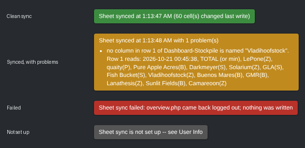

# CLOP Sheet Sync (Tampermonkey userscript)

`clop-sheet-sync.user.js` keeps the shared CLOP planning spreadsheet up to date from your own
logged-in 4clop.org session. There's no Python, no password to store, and nothing to keep running.
While you play, it reads your pages and writes your numbers to the sheet.

It only **reads** the game. It never clicks, posts, or changes anything in CLOP.

## Install

1. Install [Tampermonkey](https://www.tampermonkey.net/) in your browser.
2. Open `clop-sheet-sync.user.js` from this repo's **Raw** view. Tampermonkey offers to install it.
   (You can also go to Tampermonkey → *Create a new script*, paste the file in, and save.)
3. The first time it talks to the sheet, Tampermonkey asks whether it may connect to
   `script.google.com`. Choose **Always allow** (and do the same for `script.googleusercontent.com`
   if it asks).

## Set up (once per nation)

Go to **User → User Info** in the game. Above the password form there's a new
**Spreadsheet Sync** box for the nation you're on right now:

| Field | What to type | Example |
|---|---|---|
| **Dashboard Column Name** | Your column's header in row 1 of the `Dashboard-Stockpile` tab, exactly as written | `Vladihoofstock(Z)` |
| **Sheet Name** | The name of your nation's own tab | `VladihoofstockZ` |

Click **Save Sheet Settings** and it syncs right away. The line under the buttons says how it went.

If you have several nations on one login, switch nation with the game's nation dropdown and fill the
box in again. Settings are stored per nation, and every sync checks that all the pages it read are
for the nation it's writing.

## What it writes

Every cell is found by **looking its label up**, never by a fixed row number. Adding rows to the
sheet doesn't break anything. If a label is missing or duplicated, only the block it belongs to is
skipped, and the status line names the problem.

**Your nation tab** (Sheet Name), from `overview.php`:

- **Buildings.** Column B under the `Building` header (rows 9–51 today) gets your *have* count.
  Column B under `DISABLED:` (rows 58–97 today) gets how many are disabled. Game names map to the
  sheet's labels, so `Basic Copper Mine` becomes `Basic Mine`, every `DNA Extraction Facility - …`
  becomes `DNA`, and `Solar Collector` + `Tidal Generator` both become `Energy Collector`.
- **STOCK block.** The `HAVE` column for `apple`, `oil`, `coffee`, `mpart`, `vpart`, `gems`, plus
  the timestamp in column `W` of the `STOCK` row.
- **TROOPS block.** The `Have` column for `Cavalry`, `Tanks`, `Pegasi`, `Unicorns`, `Navy`, `Alicorns`
  (R39:R44 today), which is the total unit size of each type on `groupforces.php`, wherever the
  units are. Before writing, the script checks those counts against overview's
  *"Your military also uses … every 12 hours"* line, using the game's own upkeep rates: 5 apples
  per cavalry, 5 gasoline per tank or naval unit, 5 coffee per pegasus, 5 gems per unicorn and
  10 gems per alicorn. If they don't add up, the block is left alone and the badge says so. The
  `12h/Upkeep` rows underneath aren't written. They follow from these counts.

**`Dashboard-Stockpile`, your column only**:

- **Main block.** `Active` (the game's server time), `Sat`, `NLR`, `SE`, `GDP`, `Bits` (funds),
  the six `… - tick` rows (from Ticks-Worth), and all 31 goods from `Energy` to
  `DNA - Zebrica - South`.
- **Deals block** (under the `Deals` row; like the Market block it has no `Forbidden Research` or
  `Apotheosis Serum` rows, because those can't be traded): what your **outgoing** deals are holding, from
  `deals.php`. `Bits` is the bits you offered, and each good is the amount under *Offered Items*.
  The game takes these out of your stockpile when you add them to a deal, so this is where they
  show up. Other nations' incoming offers aren't counted.
- **Market block** (under the `Market` row): your own orders, read from the public API
  (`api/public/v1.php`, filtered to your nation id from the *View Nation* link on overview). Goods
  are the amounts on your **sell** orders. `Bits` is what your **buy** orders are holding, which is
  price × amount × your economy's buying multiplier (1.2 State Controlled, 1.03 active Free Market,
  1.1 otherwise), the same amount the game took when you placed them.

It never touches anyone else's column, the `TOTAL` column, or the `Ticks Since Recorded` row.
Cells that already hold the right value aren't rewritten. The two timestamps are always written,
and they go last, so a failed write can never leave a fresh stamp sitting over stale numbers.

## When it syncs

- **Every minute** while any 4clop.org tab is open, even if you're not clicking. It also syncs on
  page loads. However many tabs you have open, it still only syncs once a minute.
- On pages where you usually change things (Overview, Deals, Marketplace, My Offers, Transfers,
  Actions, …), every time, apart from a 10-second debounce.
- Every sync reads the game. The sheet is only written when something has actually changed. If
  nothing has changed, it leaves the sheet alone, but still refreshes the timestamps every
  30 minutes.
- **Click the badge** in the bottom-right corner to sync immediately.



The badge is green when the sync was clean, amber when it ran with problems (it lists them), red
when it failed, and grey when the sync isn't set up yet. Only one tab syncs at a time.

## Safety checks

It refuses to write anything when:

- `overview.php` comes back logged out, cut off, or without its Nation / Resources / Buildings
  panels;
- a page is for a different nation than the one you're on (for example, you switched nations
  mid-sync);
- a number on the page can't be read.

## The sheet endpoint

The script writes through a Google Apps Script web app bound to the planning spreadsheet. Its URL is
`EXEC_URL` at the top of the script, and its source is [`apps-script/Code.gs`](apps-script/Code.gs).
Nobody else needs a Google account. Retries for Google's flaky result links are built into the
script. If the deployment ever has to be redone, the sheet's owner does this:

1. In the spreadsheet: **Extensions → Apps Script**, then paste in `apps-script/Code.gs` and save.
2. **Deploy → Manage deployments**, then edit the existing deployment and choose **New version**.
   Keep *Execute as: Me* and *Who has access: **Anyone***.
3. Editing the existing deployment keeps the same URL. If you make a *new* deployment instead, put
   its URL in `EXEC_URL`.

Older deployments without the `batch` action still work. The script notices and sends one request
per range instead.

## Tests

```bash
node test/run.mjs
```

This runs the script in headless Chromium (via Playwright) against the game's real page markup
(`test/fixtures/`) and a fake sheet loaded from TSV exports of the real tabs. It checks every block
above, makes sure nothing outside your own cells changes, and covers the no-`batch` fallback, a
wrong column name, a duplicated label, troop counts that don't match the upkeep line, and a
logged-out page.
